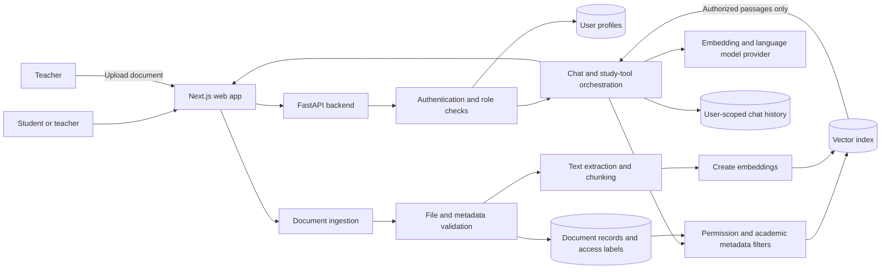

# MVP Specification: Role-Based Personalized College Chatbot

## 1. Purpose

Build a web-based academic assistant that answers student and teacher questions from approved college documents. Responses should reflect the signed-in user's academic context, cite their sources, and never expose documents the user is not authorized to access.

This MVP validates the core project idea: permission-aware retrieval-augmented generation (RAG) combined with role-specific academic assistance. It is not intended to replace the college portal, learning management system, or official academic decision-making.

## 2. Target Users

- **Student:** asks questions about courses, syllabi, college policies, and study materials; generates study notes and practice quizzes from authorized content.
- **Teacher:** asks academic or administrative questions, uploads and manages approved documents, and generates teaching notes or question sets from authorized content.
- **System operator:** provisions accounts and maintains the application and its secrets. This operational role is not a separate user-facing product experience in the MVP.

User role and academic context (such as department, semester, and subjects) must be established through a trusted process. A user must not be able to grant themselves a teacher role.

## 3. MVP Goals and Success Measures

1. Users can sign in and receive a student or teacher experience appropriate to their assigned role.
2. The chatbot answers questions using the college knowledge base and returns useful source references.
3. Retrieval and document access enforce permissions on the server, before content is passed to the language model.
4. Student answers can use department and semester context where relevant.
5. Teachers can add and manage documents with explicit access labels.
6. Users can revisit their own chat history.

Initial success is demonstrated by passing the functional acceptance criteria in Section 9, including negative access-control tests. Answer quality and retrieval quality should be measured on a small, reviewed question set before deployment beyond a controlled pilot.

## 4. MVP Scope

### Included

- Login and logout for provisioned users.
- Student and teacher roles, enforced by backend authorization.
- Basic user profile fields: role, department, semester for students, and teaching subjects for teachers.
- Teacher document upload and management for supported text-based PDF, DOCX, and TXT files.
- Document text extraction, chunking, metadata assignment, embedding, and indexing.
- Document-level access labels and metadata filters for role, department, semester, and subject when applicable.
- Chat question answering with retrieved context and source references.
- Basic personalization from the user's saved academic profile and the current conversation.
- User-scoped chat history.
- Generation of study notes and short practice quizzes grounded in authorized documents.
- A responsive web interface with login, role-appropriate dashboard/chat, document management for teachers, history, and profile views.
- Basic operational logging, input validation, and error handling.

### Not included in the first MVP

- Public self-service teacher registration or user-managed role changes.
- Student records, grades, attendance, or other sensitive individual records.
- Automated academic progress tracking or recommendations based on grades.
- Full learning-management-system, student-information-system, or single-sign-on integrations.
- Automated study calendars, exam schedules, or notifications.
- Image/OCR processing, audio, video, or scanned-document ingestion.
- Fine-tuning a language model, training custom embedding models, or autonomous agents.
- Claims that generated content is official policy, grading, or professional advice.

## 5. Core User Workflows

### Student question answering

1. Student signs in; the backend loads their assigned role and academic profile.
2. Student asks a question in the chat interface.
3. Backend authenticates the request and applies server-side document permissions and relevant academic filters during retrieval.
4. The language model receives only the question and authorized retrieved passages, with instructions to say when the knowledge base does not contain an answer.
5. The interface displays the answer and source references. The exchange is saved to that student's history.

### Teacher document publishing

1. Teacher signs in and opens document management.
2. Teacher uploads a supported file and supplies or confirms its department, subject, semester, document type, and permitted roles.
3. The backend validates the file, extracts and chunks text, attaches access metadata, and indexes it.
4. The teacher can see processing status and remove or replace a document they are authorized to manage.
5. Newly indexed content is retrievable only by users matching its access policy.

### Notes and quiz generation

1. User chooses a subject or asks for notes/practice questions in chat.
2. The backend retrieves authorized source material using the same permission checks as ordinary chat.
3. Generated notes or questions are returned with source references and are clearly presented as study aids, not official assessments.

## 6. Functional Requirements

### Authentication and roles

- **FR-1:** The system must require authentication for chat, history, profile, and document-management APIs.
- **FR-2:** The backend must determine the user's role from a trusted account record, not from client-supplied request fields.
- **FR-3:** Teacher-only APIs and resources must reject student requests, including requests made directly to the API.
- **FR-4:** The MVP must support secure account provisioning and password handling; credentials and signing secrets must not be stored in source control.

### Document management and ingestion

- **FR-5:** Authorized teachers must be able to upload, list, and remove permitted documents.
- **FR-6:** Each document and indexed chunk must carry an access policy and applicable academic metadata. Suggested fields: owner/uploader, department, semester, subject, document type, allowed roles, and document identifier.
- **FR-7:** The system must validate file type and size, report ingestion failures, and avoid indexing content when extraction or metadata validation fails.
- **FR-8:** Deleting or replacing a document must also remove or invalidate its indexed chunks so stale content is not returned.

### Chat and personalization

- **FR-9:** The chat service must retrieve relevant passages only after applying the authenticated user's access policy.
- **FR-10:** Answers should use retrieved content, include source references where available, and state when there is insufficient authorized evidence rather than inventing a college-specific answer.
- **FR-11:** Student responses may use department, semester, subject, and current conversation context. Teacher responses may use department and teaching subjects.
- **FR-12:** Users must be able to view their own chat history; one user must not be able to read another user's history.
- **FR-13:** Notes and quiz generation must use the same permission-filtered retrieval path as question answering.

## 7. Security, Privacy, and Quality Requirements

- **Access control is enforced by the backend and retrieval layer.** The language model is not an authorization mechanism. Unauthorized passages must never be included in the model prompt, citations, logs visible to users, or response payload.
- Apply least privilege and fail closed: missing or invalid role/access metadata must make a document unavailable rather than public.
- Treat uploaded files and retrieved text as untrusted input. Do not execute document content or allow it to override system instructions.
- Protect authentication tokens, passwords, API keys, and personal data. Use HTTPS in deployment and avoid logging credentials, tokens, or full sensitive document contents.
- Restrict upload size and accepted formats; handle malformed files safely.
- Keep chat history private to its owner and provide a defined retention/deletion policy before real user data is collected.
- Display that answers are AI-generated and may be incomplete; source references should identify the source document and, where possible, page or section.
- The interface should work on current desktop and mobile browsers and expose clear loading, empty, and error states.
- Define a pilot latency target and model/provider budget before deployment; the chat endpoint should return a clear timeout or service error rather than hang indefinitely.

## 8. Suggested MVP Architecture

This is a starting point from the planning conversation, not a mandated technology decision:

- **Frontend:** Next.js web application with student and teacher views.
- **Backend:** Python with FastAPI; authentication, role checks, document APIs, chat orchestration, and history access.
- **Relational storage:** PostgreSQL or MySQL for users, profiles, document records, and chat history.
- **Document processing:** PyMuPDF for PDFs and appropriate parsers for DOCX/TXT; chunking in a background-capable ingestion service.
- **Vector search:** ChromaDB or FAISS for embeddings and metadata-filtered retrieval. Choose a deployment model that supports the required isolation, persistence, and backup needs.
- **Embeddings and language model:** select a provider/model after checking data handling, cost, latency, and deployment constraints. Do not send unauthorized or unnecessary personal data to the model provider.
- **Deployment:** deploy frontend and backend with managed secrets, HTTPS, backups, and monitoring appropriate to a controlled pilot.

### Architecture diagram

### Logical request path

`Browser -> Authenticated API -> Role/profile lookup -> Permission-filtered retrieval -> LLM using authorized context -> Answer with sources -> User-owned history`

Document ingestion is a separate path:

`Teacher upload -> Validation -> Text extraction -> Chunking + access metadata -> Embeddings/index -> Authorized retrieval`

## 9. MVP Acceptance Criteria

The MVP is ready for a controlled demonstration when all of the following pass:

1. A student and a teacher can sign in and see the correct role-specific capabilities.
2. A student cannot access teacher document-management routes or teacher-only documents by changing the UI, request parameters, or API calls.
3. A teacher-only test document containing a unique marker is not returned, cited, or included in a student answer; the same authorized teacher can retrieve it.
4. A document with missing or invalid access metadata is not available to chat retrieval.
5. A question with relevant authorized source content produces an answer with a reference to that source.
6. A question with no sufficient authorized source content produces an explicit uncertainty/no-evidence response rather than an unsupported college-specific answer.
7. Department/semester filtering returns relevant content for a matching student and does not leak content restricted to another department or semester.
8. Chat history is available to its owner and inaccessible to a different user.
9. Uploading an unsupported, oversized, malformed, or unprocessable file fails safely and does not create searchable partial content.
10. Removing a document makes its content unavailable to subsequent retrieval.
11. Notes and quiz generation return source references and obey the same access-control tests as chat.
12. A small evaluation set is reviewed by project stakeholders for answer grounding, citation correctness, retrieval relevance, and response time; results and known limitations are recorded.

## 10. Delivery Plan

1. **Requirements and sample data:** agree on roles, initial departments/subjects, document access labels, and a small set of approved sample files.
2. **Foundation:** implement account provisioning, login, profiles, and backend role checks.
3. **Knowledge base:** implement upload validation, extraction, chunking, metadata, indexing, and deletion.
4. **Basic RAG:** implement permission-filtered retrieval, grounded answers, source references, and a student/teacher access-control test suite.
5. **User experience:** add chat, history, teacher document management, responsive views, and error/loading states.
6. **Study tools and pilot:** add notes and quiz generation, run the evaluation set, fix critical authorization or grounding failures, then deploy to a limited pilot.

## 11. Risks and Decisions to Resolve

- **Document ownership and access policy:** who approves documents and assigns student/teacher, department, semester, and subject access?
- **Role provisioning:** who creates teacher accounts and verifies identity?
- **Sensitive data:** will any real student-specific information be included? The MVP excludes grades and records; keep them out unless privacy, policy, and authorization requirements are formally approved.
- **Model and hosting choice:** which provider satisfies institutional data-handling requirements, budget, and latency?
- **Document quality:** scanned PDFs, tables, and outdated versions can reduce retrieval quality; establish a manual review process for the pilot.
- **Knowledge freshness:** define how updated documents replace older versions and how the system signals source dates.
- **Evaluation threshold:** agree on acceptable retrieval/answer quality and latency before expanding access.

## 12. MVP Definition of Done

The MVP is complete when the acceptance criteria pass in a test environment, the initial approved document set is indexed with reviewed access metadata, critical access-control tests are automated, known limitations are documented, and a limited pilot can be demonstrated without exposing restricted content.
